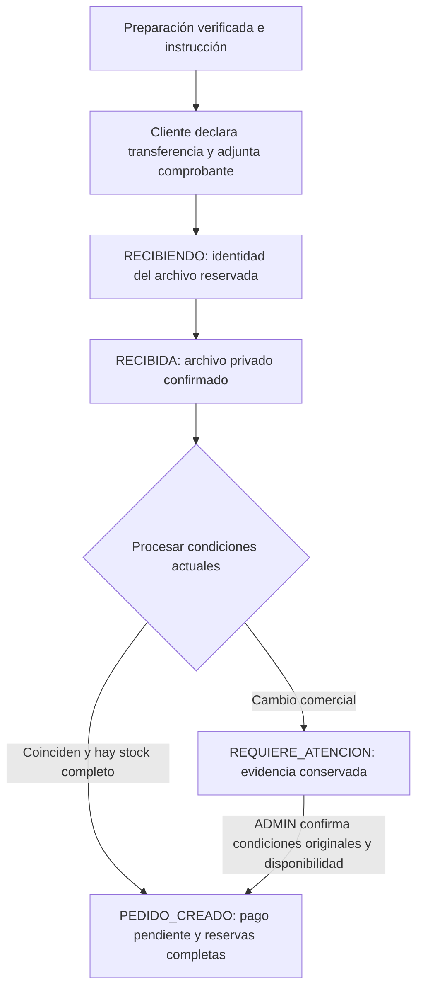

# Instrucciones de pago y recepción de compras

Continuidad al 16 de noviembre de 2026: la [atención administrativa y las correcciones](api-atencion-recepciones.md) ya están implementadas sobre el esquema vigente. Sigue su integración Angular, manteniendo nuevas emisiones desactivadas. Las referencias del cuerpo a atención futura describen la etapa original de esta guía.

Continuidad al 16 de noviembre de 2026: el [procesamiento de recepciones](api-procesamiento-recepciones.md) ya registra pedido/pago pendiente/reservas o conserva evidencia para atención. Siguen atención ADMIN y Angular; las nuevas emisiones permanecen desactivadas por defecto. Las referencias del cuerpo a procesamiento futuro describen la etapa original de esta guía.

Continuidad: el [esquema y la decimotercera migración de recepción/procedencia](esquema-recepciones-compra.md) están preparados y el usuario confirmó aplicada la decimotercera. La [API de métodos/instrucciones y preparación compartida](api-instrucciones-pago.md) y la [recepción privada recuperable](api-recepciones-compra.md) están implementadas, con nuevas emisiones desactivadas por defecto. Siguen procesamiento, atención ADMIN y Angular. Este documento conserva el análisis previo; las guías del esquema y de las API describen lo implementado posteriormente, incluidos los snapshots verificados y la recuperación del archivo privado.

Análisis y contratos propuestos del 15 de noviembre de 2026, America/Lima. Continúa el [análisis comercial](analisis-configuracion-comercial.md), el [esquema de la duodécima migración](esquema-configuracion-comercial.md) y la [API administrativa de Pagos/QR](api-configuracion-pagos.md). **Esta entrega solo modifica documentación: no implementa rutas, genera piezas, modifica Prisma ni prepara o aplica migraciones.** Las doce migraciones aplicadas proceden de la confirmación del usuario; no se consultó `soho_db` ni servicios externos.

## Decisión recomendada

Mantener el pedido y sus reservas después de adjuntar el comprobante, como en el recorrido acordado. Antes de mostrar el destino, emitir una instrucción con preparación verificada e inmutable. Después de la transferencia declarada, **registrar primero una recepción persistente del comprobante y procesar la creación del pedido como una operación posterior**.

Si las condiciones siguen siendo válidas, crear el pedido completo con reservas. Si cambiaron precio, stock, disponibilidad o envío, conservar la recepción para atención administrativa, sin crear reservas parciales, cambiar el monto ni pedir otra transferencia. Recibir una imagen significa que se recibió evidencia declarada por el cliente; no certifica ingreso de dinero ni aprueba un pago.

El esquema vigente permite emitir instrucciones, pero **no contiene una recepción privada de comprobantes independiente del pedido**. Para completar este recorrido se recomienda una ampliación compatible, como decimotercera migración, antes de habilitar cobros reales. No está generada ni aplicada. La siguiente entrega concreta sería preparar ese esquema y validar compatibilidad en MySQL temporal.

## Evidencia del funcionamiento actual

| Fuente revisada                                                                                                  | Comportamiento e implicación                                                                                                                                                                                                                                                                             |
| ---------------------------------------------------------------------------------------------------------------- | -------------------------------------------------------------------------------------------------------------------------------------------------------------------------------------------------------------------------------------------------------------------------------------------------------- |
| [PedidosService](../src/pedidos/pedidos.service.ts), `crear` e `insertar`                                        | Guarda el archivo, comprueba cobertura, tarifa/plazo, publicación, precio, stock y total, y crea pedido/pago/reservas. Si falla y no hay pedido confirmado que referencie el archivo, lo elimina. Tras una transferencia real, esa limpieza puede dejar sin evidencia persistida el conflicto comercial. |
| [DatosPedidoPipe](../src/pedidos/pipes/datos-pedido.pipe.ts) y [DTO](../src/pedidos/dto/create-pedido.dto.ts)    | Exigen comprobante y no admiten instrucción. La huella histórica incluye una selección y orden concretos de campos, datos normalizados y hash del archivo original. No puede sustituirse silenciosamente por una huella nueva.                                                                           |
| [ComprobantePago](../prisma/schema.prisma)                                                                       | Exige `pagoId`; `PagoPedido` exige pedido. No puede guardar por sí solo una recepción anterior a un pedido válido.                                                                                                                                                                                       |
| [Revisión de pagos](../src/pedidos/pagos/pagos-pedidos.service.ts)                                               | Impide aprobar un pedido en incidencia o sin reservas activas completas. Registrar un pedido incompleto para guardar el archivo trasladaría el problema a este circuito.                                                                                                                                 |
| [Recuperación de reservas](../src/pedidos/reservas/estado-reservas-pedido.ts)                                    | Solo recupera liberaciones automáticas por vencimiento, con política e historial coherentes. No recupera una reserva que nunca existió. No se fabricarán reservas liberadas ni eventos de vencimiento.                                                                                                   |
| [PedidosApi Angular](../../soho-frontend/src/app/tienda/pedidos/servicios/pedidos-api.ts)                        | Prepara clave/credencial al registrar, después de seleccionar el comprobante. Ante errores comerciales descarta el cuerpo en memoria y puede actualizar catálogo. El circuito nuevo necesita conservar la preparación anterior y distinguir recepción de pedido confirmado.                              |
| [PagoPedido Angular](../../soho-frontend/src/app/tienda/finalizar-compra/componentes/pago-pedido/pago-pedido.ts) | Métodos fijos; cambiar importe o método retira el archivo seleccionado. No debe aplicarse automáticamente ese comportamiento después de mostrar instrucciones o recibir evidencia.                                                                                                                       |
| [AccesoPedidos](../../soho-frontend/src/app/tienda/pedidos/servicios/acceso-pedidos.ts)                          | Ya genera UUID y credencial invitada aleatoria y conserva referencias por propietario en `sessionStorage`. Se adelantará su preparación al momento anterior a emitir instrucciones.                                                                                                                      |

No basta ampliar el mensaje de un 409: el recibo debe seguir siendo consultable aunque no exista pedido o el navegador se cierre después de aceptarlo.

## Alternativas evaluadas

| Alternativa                                           | Evaluación                                                                                                                                                                                                |
| ----------------------------------------------------- | --------------------------------------------------------------------------------------------------------------------------------------------------------------------------------------------------------- |
| Crear pedido y reservar antes de mostrar el pago      | Reduce la carrera de stock, pero cambia el flujo acordado, inicia reservas antes del comprobante y exige redefinir abandonos y vencimientos. No se incorpora a esta propuesta.                            |
| Crear siempre un pedido en `INCIDENCIA`, sin reservas | Exige redefinir qué representa un pedido, sus agregados y la resolución de incidencias generales. Las API actuales de recuperación y aprobación no resuelven ese caso. No se usará como atajo.            |
| Recepción persistente y posterior registro de pedido  | Recomendada: conserva evidencia, mantiene las invariantes de pedidos/reservas y da una referencia recuperable a la atención previa al pedido. Requiere persistencia y un circuito administrativo propios. |

## Flujo y estados



- **Instrucción emitida:** conserva método/versionado, destino, preparación y monto de referencia; no reserva unidades ni prueba una transferencia.
- **RECIBIENDO:** existe un intento recuperable de recepción, pero el archivo todavía no está confirmado. No se anuncia «comprobante recibido» ni se permite crear pedido.
- **RECIBIDA:** hay referencia persistida a un archivo privado confirmado. La creación de pedido puede intentarse sin reenviar la imagen.
- **REQUIERE_ATENCION:** se conserva la recepción y sus motivos; el cliente no vuelve a cotizar ni intenta otra transferencia automáticamente. Requiere decisión administrativa.
- **PEDIDO_CREADO:** recepción vinculada a un único pedido, instrucción y pago. Desde aquí, revisión, corrección, cancelación y despacho usan las API existentes.

La fase de recepción termina y confirma sus datos antes de comenzar la transacción de pedido. Una caída en la segunda fase no revierte ni elimina el comprobante ya recibido. No se necesita un trabajador automático para la primera implementación: Angular solicitará el procesamiento y podrá recuperarlo después; las recepciones pendientes también serán visibles para ADMIN.

## Preparación anterior a transferir

El servidor validará una preparación completa: contacto, entrega, facturación opcional, artículos y cotización. Incluir estos datos antes de emitir evita vincular después una transferencia con otra dirección, carrito o titular de compra por un cambio local accidental.

Se mantienen las reglas actuales de contrato: hasta cincuenta SKU distintos y cien pares en total, cantidades enteras, importes PEN como cadenas con dos decimales, documentación de facturación y validación de entrega existentes. El navegador expresa cantidades y valores esperados; el servidor obtiene variantes, precio, disponibilidad, cobertura, tarifa, plazo y total desde sus fuentes autorizadas.

Se reorganizarán las reglas de lectura y cálculo de `PedidosService` para compartirlas con la emisión y el procesamiento. No llamar al método que inserta el pedido para obtener una cotización ni duplicar cálculos en otro servicio. Usar Decimal; no calcular importes bancarios con `number` ni aceptar totales del cliente como autoridad.

Conservar exactamente estos distritos y sus códigos:

| Código              | Distrito             |
| ------------------- | -------------------- |
| `la-esperanza`      | La Esperanza         |
| `trujillo`          | Trujillo             |
| `el-porvenir`       | El Porvenir          |
| `florencia-de-mora` | Florencia de Mora    |
| `victor-larco`      | Víctor Larco Herrera |
| `huanchaco`         | Huanchaco            |
| `moche`             | Moche                |

La Esperanza conserva envío gratuito. Para los demás, consultar habilitación y tarifa reales; no rellenar valores pendientes ni asumir los estados iniciales del seed. Antes de transferir, una zona no cotizable impide emitir instrucciones. Un cambio posterior no impide recibir el comprobante: deriva a atención.

La huella de preparación tendrá un contrato explícito `versionContrato: 1`: normalización de texto y opcionales, orden estable de artículos por SKU y representación decimal fija. Excluye comprobante, datos de sesión y campos de presentación mutables; incluye contacto, entrega completa, facturación, SKU/cantidades/precios esperados y cotización verificada. Se conservará también el valor normalizado, no solo su SHA-256.

`InstruccionPago.respuesta` puede guardar desde su inserción una respuesta versionada con esa preparación y snapshots verificados de identidad de variantes, importes, distrito/plazo y destino. Ese JSON queda inmutable y se valida al recuperarlo; no se le agregarán después estados de recepción o archivos. Un hash aislado no permite reconstruir un carrito, monto o dirección después de perder el navegador. No hace falta editar la duodécima migración para versionar el contenido de esa respuesta.

La instrucción fija el destino y registra la preparación que se mostró, sin inmovilizar condiciones. El pedido utilizará sus importes originales únicamente bajo las reglas de procesamiento descritas abajo. Un cambio de fotografía o nombre no redefine la identidad SKU ni genera una recotización; al registrar el pedido se seleccionará una imagen vigente y disponible y se guardará su FK histórica como hoy. Esta propuesta no promete conservar una fotografía de catálogo desde la emisión de la instrucción.

## Política cuando cambian las condiciones

| Situación                                                               | Resultado propuesto                                                                                                                                                   |
| ----------------------------------------------------------------------- | --------------------------------------------------------------------------------------------------------------------------------------------------------------------- |
| Cambia configuración de Pagos antes de emitir                           | 409 con versión actual para revisar. No mostrar un destino mezclado ni seleccionar el nuevo automáticamente.                                                          |
| Método sin datos o desactivado antes de emitir                          | No emitir ni mostrar instrucciones nuevas.                                                                                                                            |
| Cambia/desactiva el método o su QR después de emitir                    | Conservar y aceptar la instrucción ya emitida y su destino histórico. No volver a exigir que el método siga vigente para recibir el comprobante o vincular el pedido. |
| Condiciones comerciales coinciden y todas las líneas tienen stock libre | Crear pedido/reservas completos, con pago y comprobante pendientes de revisión.                                                                                       |
| Precio cambia, tanto si sube como si baja                               | `REQUIERE_ATENCION`. No cambiar el monto de referencia ni cobrar/reembolsar diferencias automáticamente.                                                              |
| Cambia tarifa, plazo, cobertura o falta tarifa vigente                  | `REQUIERE_ATENCION`, conservando lo cotizado antes de transferir.                                                                                                     |
| Falta una línea, se archiva un producto o se deshabilita su variante    | `REQUIERE_ATENCION`. No reservar solo las líneas disponibles, sustituir SKU/talla/color o consumir reservas ajenas.                                                   |
| Hay error de persistencia durante el procesamiento                      | Mantener `RECIBIDA` si no hubo COMMIT; recuperar la operación antes de repetirla. El archivo fuente permanece.                                                        |
| Imagen inválida o datos sin autorización                                | Rechazar la recepción. Pedir una imagen válida del mismo pago cuando corresponda; no sugerir otra transferencia.                                                      |

Ejemplo: el comprador recibió una preparación de S/ 200.00 más S/ 6.00 de envío y declara transferidos S/ 206.00. Si el precio pasa a S/ 220.00 o el envío a S/ 8.00, su recepción sigue mostrando S/ 206.00. Si falta stock ocurre lo mismo: queda pendiente de atención, sin reservar unidades ficticias. Esa referencia no prueba el monto realmente abonado.

ADMIN podrá registrar el pedido **aceptando expresamente las condiciones originales**, con versión vigente de recepción, motivo y confirmación. No podrá introducir un total distinto en esa acción. Se exigirán todas las unidades libres, variantes habilitadas, productos publicables y cobertura nuevamente habilitada y cotizable. Si esas condiciones no se cumplen, la recepción seguirá en atención; reponer inventario se hará por el flujo de movimientos existente.

Aceptar las condiciones originales es una recomendación operativa explícita de este diseño; no se ha aplicado a ventas reales. No se promete automáticamente el precio histórico ni una entrega imposible. Si SOHO y el cliente necesitan otra dirección, composición, monto, devolución o pago adicional, hará falta un flujo posterior con consentimiento y auditoría. Mientras tanto se conserva la recepción y se atiende el caso, sin cerrar automáticamente una obligación económica ni marcar un reembolso ficticio.

La primera implementación puede solicitar y recibir correcciones de imagen de la misma transferencia antes de crear pedido. Mantendrá versiones y la instrucción original. Una segunda transferencia, otro método o un cambio de beneficiario no se resolverán como «corrección del comprobante» ni crearán automáticamente un segundo pedido.

## Contratos propuestos

**Ninguna de las rutas de esta sección está implementada por esta entrega.** Todas las respuestas privadas usan `Cache-Control: no-store`, `nosniff` y `Referrer-Policy: no-referrer`. Las escrituras exigen origen y CSRF; reutilizar sesión/credencial invitada y límites actuales. Los documentos privados no tendrán URL pública o firmada ni se subirán al dominio Cloudinary de QR.

### Métodos e instrucciones

| Método y ruta                                     | Contrato                                                                                                                                               |
| ------------------------------------------------- | ------------------------------------------------------------------------------------------------------------------------------------------------------ |
| `GET /api/configuracion/pagos`                    | Público: `{ version, disponible, metodos: [{ metodo, nombre }] }`. Sin número, titular, QR ni auditoría. Sin métodos disponibles devuelve lista vacía. |
| `POST /api/pagos/instrucciones`                   | Propietario: emite o recupera por clave, con método/versión esperados y preparación completa.                                                          |
| `GET /api/pagos/instrucciones/operaciones/:clave` | Propietario: recupera una emisión por clave si se perdió su UUID.                                                                                      |
| `GET /api/pagos/instrucciones/:id`                | Propietario: devuelve la instrucción inmutable. Definir rutas estáticas antes de `:id`.                                                                |

Cuerpo de emisión, usando la estructura de contacto/entrega/facturación del [contrato de pedidos](api-pedidos.md):

```text
{
  claveSolicitud: UUID v4,
  claveCreacionPedido: UUID v4,
  metodo: "YAPE" | "PLIN",
  versionConfiguracionEsperada: entero positivo,
  preparacion: {
    contacto,
    entrega,
    facturacion?,
    articulos: [{ sku, cantidad, precioUnitarioEsperado }],
    cotizacion: { costoEnvio, plazoEntrega, total }
  }
}
```

Respuesta: `{ versionContrato: 1, instruccionId, claveCreacionPedido, metodo, versionConfiguracion, emitidaEn, moneda: "PEN", importeReferencia, preparacion, destino: { celular, titular, qr }, accesoExpiraEn }`. La preparación devuelta contiene la forma normalizada y verificada; QR es nulo si se paga por número. `accesoExpiraEn` es nulo para cuentas y una fecha del servidor para invitado.

La misma clave/contenido/propietario devuelve la respuesta original antes de comprobar si la configuración comercial cambió después. Otro contenido o propietario genera conflicto; las consultas ajenas devuelven 404. Preparar UUID y credencial **antes** de emitir y conservarlos al recuperar. No se atribuyen instrucciones por correo ni se aceptan `usuarioId`, roles o hashes de propietario desde el cuerpo.

Puede haber varias instrucciones todavía no utilizadas para una misma clave de checkout, como permite el esquema. Cambiar método antes de transferir será explícito; ninguna recarga emitirá otra instrucción automáticamente. Una recepción ya registrada fija cuál se utilizó y no admite cambiarla por una emisión nueva.

### Recepción y recuperación del comprobante

| Método y ruta                                                | Contrato                                                                                                                                                                   |
| ------------------------------------------------------------ | -------------------------------------------------------------------------------------------------------------------------------------------------------------------------- |
| `POST /api/pagos/recepciones`                                | Propietario: recibe `{ claveSolicitud, instruccionPagoId, comprobante }`; no recibe otra cotización, carrito, entrega ni total. Usa la preparación congelada del servidor. |
| `GET /api/pagos/recepciones/creacion/:clave`                 | Propietario: recupera por la clave de recepción, incluso sin pedido ni respuesta de creación.                                                                              |
| `GET /api/pagos/recepciones/:id`                             | Propietario: estado/versión actuales, referencia, preparación, motivos públicos, metadatos del comprobante, capacidades y pedido si existe.                                |
| `GET /api/pagos/recepciones/:id/comprobantes/:comprobanteId` | Propietario: streaming privado del archivo confirmado, con límites y pertenencia comprobados.                                                                              |
| `POST /api/pagos/recepciones/:id/procesamiento`              | Propietario: `{ claveSolicitud, versionEsperada }`. Solo una recepción `RECIBIDA`; intenta crear el pedido o registra atención por cambios comerciales.                    |
| `POST /api/pagos/recepciones/:id/comprobantes`               | Propietario: nueva versión de imagen de la misma transferencia, solo si se solicitó corrección; exige clave, versión y el contrato de comprobante existente.               |

`comprobante` conserva nombre, MIME, base64 canónico y número de operación opcional, con límites actuales de imagen: 5 MiB, estática, veinte megapíxeles y 8192 píxeles por lado. Se mantendrá el JSON grande y su validación antes de leerlo. Hay que ampliar expresamente la selección de rutas de `cuerpoJsonGeneral` y el middleware de tamaño/CSRF/límites: por defecto Express solo acepta 16 KiB para otras rutas. El procesamiento y la emisión usan el límite pequeño, pues no contienen imagen.

No volver a pedir todos los datos de compra al recibir el comprobante evita que un cambio local después de transferir vuelva a definir su preparación. La recepción queda ligada por servidor a instrucción, propietario, método y clave de creación del pedido. Se permite una sola recepción para esa instrucción y una sola por clave de checkout. Un intento con otra clave para esa misma compra recuperará la existente cuando coincida o dará conflicto; no duplica registros.

POST de recepción devuelve 201 cuando confirma una recepción nueva con imagen, 202 si solo puede confirmar el intento `RECIBIENDO`, y 200 al recuperar una recepción confirmada repetida. Una respuesta final confirmada se conserva para idempotencia; GET devuelve el estado vigente. Un resultado incierto no se resuelve generando otra clave.

Procesar devuelve 200 para un resultado comercial registrado: `{ recepcion, resultado: "PEDIDO_CREADO" | "REQUIERE_ATENCION", pedido }`. El caso de atención es un resultado persistido, no un error que invite al navegador a descartar la imagen. Si falla la infraestructura antes de confirmar, 503 y recuperación por clave de operación. Las repeticiones devuelven su resultado original; las lecturas muestran el estado actual.

### Atención administrativa previa al pedido

| Método y ruta                                                | Contrato                                                                                                                                                                             |
| ------------------------------------------------------------ | ------------------------------------------------------------------------------------------------------------------------------------------------------------------------------------ |
| `GET /api/admin/recepciones`                                 | ADMIN: listado paginado, búsqueda, filtro por estado y conteos completos, separado de ventas/pagos aprobados.                                                                        |
| `GET /api/admin/recepciones/:id`                             | ADMIN: detalle, preparación original, diagnóstico actual, historial y capacidades.                                                                                                   |
| `GET /api/admin/recepciones/:id/comprobantes/:comprobanteId` | ADMIN: archivo privado de esa recepción.                                                                                                                                             |
| `POST /api/admin/recepciones/:id/registro-pedido`            | ADMIN/CSRF: clave, versión esperada, comprobante actual, motivo, `aceptarCondicionesOriginales: true` y `confirmado: true`. Vuelve a comprobar disponibilidad completa bajo bloqueo. |
| `POST /api/admin/recepciones/:id/solicitud-correccion`       | ADMIN/CSRF: clave, versión, comprobante actual, motivo/mensaje y confirmación. No cambia método ni destino.                                                                          |
| `GET /api/admin/recepciones/:id/operaciones/:clave`          | ADMIN responsable: recuperación de una decisión propia sin repetir escrituras.                                                                                                       |
| `GET /api/pagos/recepciones/:id/operaciones/:clave`          | Propietario: recuperación de su operación de procesamiento o corrección.                                                                                                             |

Una recepción en atención no figura como pedido, venta aprobada ni incidencia de reserva vencida. Requiere una bandeja administrativa propia con pendientes `RECIBIENDO`, `RECIBIDA` y `REQUIERE_ATENCION`. Registrar un pedido conserva pago pendiente de revisión y origen del comprobante; la aprobación bancaria/manual usa después el servicio existente y comprueba las reservas.

## Persistencia que falta

Se propone preparar tres modelos nuevos; sus definiciones Prisma/SQL se revisarán en la siguiente entrega:

| Modelo propuesto             | Responsabilidad e invariantes                                                                                                                                                                                                                                                                                                                                                                         |
| ---------------------------- | ----------------------------------------------------------------------------------------------------------------------------------------------------------------------------------------------------------------------------------------------------------------------------------------------------------------------------------------------------------------------------------------------------- |
| `RecepcionCompra`            | UUID y referencia legible propia —distinta de `SOHO-…`—, instrucción y clave de checkout únicas/coherentes, hash y clave de recepción, versión, estado, motivos, fechas, vencimiento de acceso invitado y pedido opcional único. El propietario se obtiene de la instrucción; no se escoge ni se cambia desde la petición. `PEDIDO_CREADO` exige pedido; no se anuncian reservas antes de ese estado. |
| `ComprobanteRecepcionCompra` | Versiones anexadas, identidad reservada del archivo privado, SHA-256 original y preparado, bytes/MIME/nombre, número de operación opcional, estado de almacenamiento, claves/hash y fechas. Versiones anteriores no se sobrescriben. Una recepción utilizable exige un comprobante confirmado y no basta la existencia del intento.                                                                   |
| `OperacionRecepcionCompra`   | Clave/contexto/hash, versión esperada y resultante, acción, actor/responsable o propietario, motivo, antes/después y respuesta recuperable. Admite registrar el intento y su resultado para recuperar una operación interrumpida, sin repetir una conversión confirmada. Guarda también la identidad reservada de la copia privada destinada al pedido cuando corresponda.                            |

Reutilizar `InstruccionPago`, sus FK compuestas y las relaciones de pedido/pago de la duodécima. La ampliación deberá exigir claves y vínculos coherentes, índices de bandeja/paginación, estados/fechas válidos y `RESTRICT` para historial. La igualdad de propietario entre tablas y las transiciones siguen siendo responsabilidad transaccional del servicio; no atribuir a un `CHECK` validaciones que consultan otras filas.

Se recomienda una referencia nullable y única `comprobanteRecepcionId` desde `ComprobantePago` a la versión de recepción utilizada como origen. Los comprobantes anteriores quedan con `NULL`, sin orígenes inventados. Este enlace acredita procedencia de la imagen, no confirmación de fondos. Los nombres y detalles de índices/campos se concretarán al preparar la migración nueva; las doce anteriores no se modificarán.

No colocar el recibo nuevo en `InstruccionPago.respuesta`, fabricar un `PagoPedido` sin pedido o usar una alerta de inventario para almacenar la incidencia. La respuesta inmutable de emisión y el historial de recepción tienen responsabilidades diferentes.

## Archivo privado y fallos entre disco y MySQL

No existe una transacción única entre MySQL y disco. La implementación debe reservar en MySQL la identidad y metadatos del archivo antes de escribirlo. Escribir de forma exclusiva y, al recuperar, comprobar bytes y SHA-256 de la identidad reservada. Solo después confirmar `RECIBIDA`. Un archivo ya vinculado a una recepción no se elimina porque falle el procesamiento comercial.

Si el archivo existe y coincide después de una caída, completar la confirmación sin otra transferencia. Si aún no existe, permitir reenviar la misma imagen con la misma clave. Si se cerró el navegador antes de confirmar el archivo, será necesario volver a adjuntar evidencia de aquella transferencia; la API no puede recuperar bytes que nunca recibió. Los mensajes distinguen esta situación de un comprobante ya aceptado y consultable.

Para el pedido, se recomienda conservar el archivo fuente de recepción y crear **una copia privada independiente** mediante el mismo servicio de almacenamiento, sin recodificar de nuevo. La copia mantiene hash y bytes, usa otra clave y enlaza su procedencia por `comprobanteRecepcionId`. Esto evita que la limpieza de un intento de pedido borre el archivo fuente de recepción. Cuesta una copia adicional de la imagen; evita migrar todos los comprobantes históricos a un nuevo almacén compartido.

Reservar también la identidad de esa copia en la operación antes del IO para recuperar caídas o un COMMIT incierto. La limpieza solo podrá retirar una copia de intento cuando se compruebe que ningún pedido u operación confirmada la utiliza. Si la base no permite comprobarlo, conservarla. Reutilizar y adaptar `ComprobantesPrivadosService`; no crear un segundo almacén ni devolver rutas del disco al cliente.

## Bloqueos, procesamiento y reservas

Orden común para las nuevas operaciones: recepción → instrucción → versiones de comprobante seleccionadas → configuración de reservas y zona → variantes/productos y fotografías en el orden estable del circuito actual → revalidación de sesión cuando corresponda. Lecturas finales deben hacerse después de bloquear. La implementación comprobará también los órdenes ya usados por pagos, envíos, publicación y archivo, con pruebas reales de intercalado y reintentos de deadlock; no se declarará libre de conflictos solo por ordenar UUID.

La emisión bloqueará la fila única de Pagos en modo compartido, validará método vigente y preparación y revalidará identidad antes de insertar la instrucción. No crea recepción, archivo ni reservas. La recepción comprobará instrucción y propietario; no bloqueará su aceptación por cambios posteriores de catálogo o configuración.

El procesamiento bloqueará la recepción y leerá primero una operación repetida. Si ya hay pedido, lo recuperará sin crear otro. Para un intento nuevo, volverá a comprobar preparación, inventario disponible y coherencia del contador reservado con reservas activas. Si hay un cambio comercial, insertará su diagnóstico y transición a atención sin modificar inventario. Un reintento con otra clave no evita el bloqueo administrativo de atención.

Si puede registrar el pedido, hacerlo en una transacción completa:

1. Revalidar propietario/ADMIN, recepción, versión y comprobante; en atención, exigir la confirmación administrativa de condiciones originales.
2. Obtener bloqueos y comprobar todas las líneas y cobertura; no reservar parcialmente.
3. Leer la política de reservas **actual al crear el pedido**. No copiar una política supuestamente histórica de emisión: entonces no hubo reservas.
4. Crear pedido, artículos/unidades y reservas completas usando la preparación del servidor y las condiciones originales aceptadas.
5. Vincular `InstruccionPago.pedidoId` con UUID y clave de creación coherentes, y después crear `PagoPedido` con la instrucción y su comprobante privado de origen.
6. Registrar eventos reales, vincular recepción/pedido y guardar la respuesta de la operación; confirmar todo junto.

El orden pedido → vínculo de instrucción → pago respeta las FK inmediatas existentes. Una caída revierte pedido, vínculos e inventario; conserva recepción y fuente de evidencia. Aprobar después no exige que el receptor siga activo. Vencimientos, cancelación y despacho actúan sobre reservas reales creadas en esa transacción y conservan sus políticas históricas.

## Identidad, acceso y recuperación

Las cuentas usan cookie/sesión actual y solo reutilizan instrucciones o recepciones de su `Usuario.id`. Una cookie inválida no transforma la compra en invitado. ADMIN tendrá consulta separada para atención y no podrá apropiarse de una solicitud ajena. Los invitados reutilizan los 32 bytes aleatorios en `X-Pedido-Acceso`; el servidor guarda/verifica solo SHA-256 y no usa UUID, correo o código visible como autorización.

Se propone conservar el plazo privado actual de treinta días: acceso a una instrucción invitada desde su emisión; acceso a una recepción desde su registro; acceso al pedido desde su creación como en el backend actual. Devolver el vencimiento calculado por servidor para cada recurso, sin renovarlo con lecturas/reintentos. Una recepción consultable incluye su destino histórico aunque el plazo del acceso directo a la instrucción haya terminado. Estos límites de acceso no borran registros ni invalidan una transferencia declarada; después del plazo se requerirá atención con verificación de identidad, no un nuevo pago ni una recuperación pública por correo.

`sessionStorage` conservará referencias, claves, propietario, credencial invitada y vencimientos devueltos; la imagen no se persistirá ahí. Tras confirmar la recepción se recupera desde el backend. El cierre de la pestaña puede perder una credencial invitada guardada solo en sesión: el contrato no promete recuperación automática sin esa credencial. La pérdida de acceso requiere atención privada. Nunca convertir una recepción invitada en compra de cuenta por compartir correo o porque alguien inicia sesión.

Cada acción tendrá una clave y contexto estables, hash normalizado y respuesta de resultado final. Las repeticiones se reconocen antes de exigir versión vigente o método actualmente habilitado. La recepción compara también los bytes originales: dos imágenes distintas no se consideran la misma solicitud aunque su preparación de imagen coincida. Dos intentos simultáneos de la misma compra no crean dos recepciones ni dos pedidos.

El detalle del pedido podrá incluir una proyección privada de su instrucción histórica. Para pagos previos devolverá `instruccion: null` y destino no registrado. Corregir el comprobante, aprobar, cancelar o despachar no sustituye ese destino por el actual.

## Compatibilidad y activación

No añadir campos nulos a la huella v1 de `POST /api/pedidos`. Conservar su validación, normalización y cálculo exactos para solicitudes ya confirmadas. Primero recuperar por clave y comprobar propietario/huella; devolver el pedido anterior aunque no tenga instrucción y aunque la configuración de Pagos ya cambió.

El recorrido nuevo finaliza mediante recepciones y creación interna del pedido; el cliente no tiene que reconstruir el cuerpo grande de `CreatePedidoDto` desde un carrito modificado. Tras activar el nuevo circuito, una clave v1 no confirmada no podrá crear una compra nueva saltándose la instrucción: devolverá `INSTRUCCION_PAGO_REQUERIDA`, sin adjuntar el nuevo campo al hash antiguo.

Se recomienda una capacidad de despliegue, desactivada inicialmente, por ejemplo `PAGOS_CHECKOUT_ACTIVO`. Antes de activarla, no emitir destinos utilizables ni retirar el aviso del checkout por el mero guardado de Pagos. Activar conjuntamente el circuito nuevo completo y el bloqueo de creaciones v1 nuevas, después de pruebas y despliegue Angular compatible. Una pausa posterior impide emisiones nuevas; sigue permitiendo recibir/atender instrucciones ya emitidas y recuperar pedidos anteriores. El nombre y configuración final del interruptor se concretarán al implementar.

No liberar esta funcionalidad solo con el endpoint de emisión: el destino no se expondrá hasta que recepción persistente, procesamiento, atención y recuperación estén disponibles. Backend, contratos y Angular deberán desplegarse en ese orden de compatibilidad.

## Cambios futuros de Angular

- Preparar identidad, UUID de checkout y credencial antes de mostrar cualquier destino; cargar métodos disponibles y pedir la instrucción con la preparación verificada.
- Mostrar número/titular/QR y monto únicamente desde esa respuesta. Una recarga o cambio administrativo no los reemplaza mientras el comprador adjunta evidencia de la misma transferencia.
- Conservar la referencia emitida ante cambios locales; antes de transferir, cambiar datos exige una nueva preparación explícita. Después de declarar transferencia, conservar la anterior para recepción/atención.
- Distinguir `RECIBIENDO`, comprobante recibido, atención y pedido creado. Mensaje de atención propuesto: «Recibimos tu comprobante. La compra necesita revisión antes de generar el pedido. No realices otra transferencia».
- Recuperar recepción y operación antes de reenviar; las claves nuevas no resuelven resultados inciertos. No vaciar carrito ni abrir la confirmación actual de pedido solo porque se recibió una imagen.
- Al obtener `PEDIDO_CREADO`, conservar el comportamiento de vaciar únicamente el carrito que coincide y abrir confirmación. Desde entonces usar Mis pedidos y las correcciones existentes.
- El cambio de sesión retira datos ajenos y conserva los registros del servidor. Añadir bandeja ADMIN de recepciones con consultas remotas, versiones y recuperación propias; no simularla con los quince eventos de demostración.

## Casos de aceptación y orden de entregas

La implementación deberá probar, en MySQL temporal y almacenamiento privado temporal:

1. Métodos desactivados, activo sin QR, versión cambiada y publicación simultánea con emisión; respuesta completa de una sola versión.
2. Preparación con precio/stock/cobertura inválidos antes de transferir, sin instrucciones ni reservas parciales.
3. Repetición de emisión, propietario ajeno, cookie inválida, invitado, claves distintas y recuperación sin conocer el UUID.
4. Archivo inválido, límite JSON grande, CSRF previo al cuerpo, fallo de disco y caída después de escribir pero antes de confirmar metadatos.
5. Recepción confirmada seguida de cambio de precio —sube/baja—, tarifa, plazo, distrito deshabilitado, archivo comercial y stock insuficiente en una sola línea. Evidencia consultable sin pedido ni reservas.
6. Dos recepciones para la misma instrucción/checkout, misma clave con otro archivo y dos procesamientos concurrentes; máximo un pedido y sin reserva doble.
7. Recepción/registro con método cambiado o desactivado después de emitir, conservando destino e importe originales.
8. Pérdida de respuesta después del COMMIT de recepción o procesamiento; recuperación de resultado original y consulta del estado vigente.
9. Atención ADMIN con versión antigua, permiso revocado durante espera, reserva concurrente, corrección de imagen y confirmación de condiciones originales; rollback completo de pedido y conservación del archivo fuente.
10. Pago inicialmente pendiente, revisión manual, corrección, vencimiento de reservas, cancelación y despacho: origen/destino históricos intactos, sin aprobar por recibir una imagen.
11. Pedidos v1 confirmados recuperados con su cuerpo y hash anteriores; creación v1 nueva bloqueada solo al activar el circuito completo.
12. Sesión/cambio de cuenta, credencial invitada perdida o vencida, pausa de emisiones y restauración del navegador. No exponer datos ni renovar plazos por consultar.

Orden recomendado:

1. **Preparar esquema compatible de recepción y procedencia de comprobantes**, revisar la decimotercera migración y validar actualización con datos y esquema vacío. No aplicarla a `soho_db` como preparación de pruebas.
2. Implementar preparación compartida, catálogo de métodos e instrucciones, todavía sin activación pública del cobro.
3. Implementar recepción privada, archivo recuperable, procesamiento y atención ADMIN, con compatibilidad v1 y operaciones idempotentes. Nuevas piezas mediante Nest CLI.
4. Integrar Angular de Pagos/checkout y bandeja de recepciones; probar el recorrido completo y activar la capacidad de despliegue.
5. Continuar el circuito independiente de Tienda y sus contenidos, sin confundirlo con SMTP ni con condiciones de reembolso.

La matriz anterior es un plan de pruebas, no pruebas ejecutadas en este análisis. Solo se comprobaron documentación, enlaces y hashes de fuentes/esquema/pruebas, sin conectarse a bases o proveedores. Evidencia: `.checkout-review/analisis-instrucciones-pago/validacion.json`.
