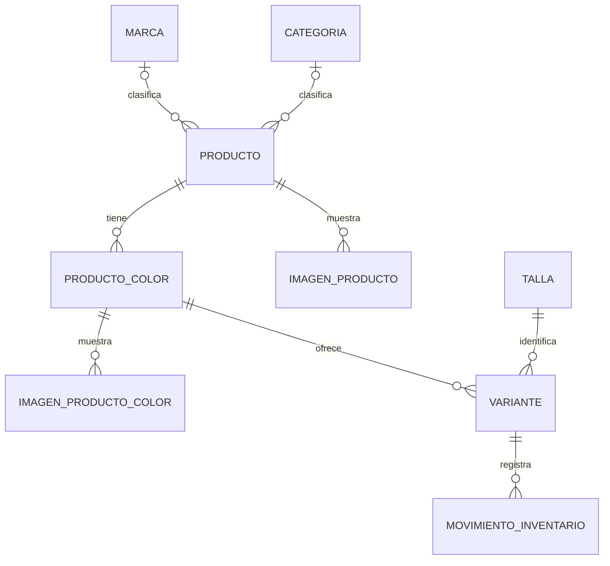

# Esquema inicial del catálogo e inventario

Fecha: 13 de noviembre de 2026 (America/Lima).

El esquema está en `prisma/schema.prisma`; la migración inicial está en `prisma/migrations/20261113000000_catalogo_inicial/migration.sql`. Define una sola fuente de datos para tienda y Administración. Este documento registra la estructura y su validación inicial. La conexión de NestJS y la carga posterior del catálogo se documentan en [Conexión y datos iniciales](conexion-datos-iniciales.md).

## Relaciones



Marca y categoría son opcionales en el registro de un producto mientras sea borrador. Las demás relaciones requieren que exista el registro padre.

| Modelo Prisma          | Tabla MySQL               | Responsabilidad                                                                         |
| ---------------------- | ------------------------- | --------------------------------------------------------------------------------------- |
| `Marca`                | `marcas`                  | Código, nombre, slug, logotipo, altura de presentación, estado y orden                  |
| `Categoria`            | `categorias`              | Nombre, slug, estado y orden                                                            |
| `Producto`             | `productos`               | Identidad comercial, datos generales, género, precio común, estado y orden del catálogo |
| `ProductoColor`        | `producto_colores`        | Código, nombre y tono de un color dentro de un producto                                 |
| `Talla`                | `tallas`                  | Sistema EU, valor numérico y orden                                                      |
| `Variante`             | `variantes`               | SKU, combinación de color y talla, habilitación, existencias y reservas                 |
| `ImagenProducto`       | `imagenes_producto`       | Galería general ordenada, con texto alternativo                                         |
| `ImagenProductoColor`  | `imagenes_producto_color` | Galería ordenada de un color, con texto alternativo                                     |
| `MovimientoInventario` | `movimientos_inventario`  | Delta, saldos, motivo, referencia, origen y fecha del movimiento                        |

## Identidad y unicidad

- Las claves primarias son UUID de 36 caracteres. Prisma los genera al crear registros; una importación SQL directa debe aportar los identificadores.
- `Producto.id`, `Producto.slug`, `Producto.codigoInterno` y `Producto.codigoModelo` tienen funciones distintas. Los enlaces actuales pueden conservarse usando identificadores como `samba` o `af1` en el slug al preparar los datos iniciales.
- Son únicos los códigos y slugs de marcas, los slugs de categorías, los slugs y códigos internos de productos y los SKU. El nombre de producto y el código de modelo también son únicos, conservando las validaciones actuales de Administración.
- Un código de modelo pendiente se guarda como `NULL`. MySQL permite varios `NULL` en esa restricción única; no se utiliza una cadena vacía como sustituto.
- No se repiten código ni nombre de color dentro del mismo producto, sistema y valor de talla, combinación de color y talla ni posición de una imagen dentro de su galería.
- La migración usa `utf8mb4_unicode_ci`: la igualdad en índices de texto ignora mayúsculas y acentos. El servidor deberá recortar los textos y normalizar códigos y slugs antes de guardar.
- Todas las relaciones tienen claves foráneas y borrado/actualización restringidos. Los productos se archivan y las variantes se deshabilitan; no se habilita el borrado de su historial.

## Productos, precios y publicación

`estado` admite `BORRADOR`, `PUBLICADO` y `ARCHIVADO`. No se guarda otro booleano `publicado`; la API lo podrá proyectar desde ese estado para las interfaces actuales.

Los borradores tienen nombre, slug y código interno, y pueden dejar marca, categoría, modelo, código de modelo y precio pendientes. Los datos pendientes se representan con `NULL`; la descripción puede estar vacía. Unisex usa un único producto y las mismas variantes en las secciones Hombre y Mujer.

El precio corresponde al producto completo, sin precios por talla o color. `precio` y `precioAnterior` son `DECIMAL(8,2)` en PEN, con máximo S/ 999,999.99. El precio anterior solo se acepta cuando existe precio actual y es mayor que él. La condición de oferta se calcula a partir de esos importes; no se guarda un segundo indicador de oferta.

Las restricciones SQL verifican precios positivos y los datos propios mínimos del producto publicado: precio, modelo y código de modelo. Antes de publicar, el servicio deberá verificar también marca, categoría, al menos una fotografía general y una variante habilitada dentro de la misma transacción. Las comprobaciones entre tablas no quedan resueltas por un `CHECK` de fila.

`ordenCatalogo` permite conservar la relevancia explícita. Los índices cubren estado y orden, precio, género, novedades y relaciones con marca/categoría. Los índices de colores y tallas permiten localizar variantes; los filtros combinados deberán coincidir en una misma variante disponible. La implementación de búsqueda y sus planes de ejecución se revisará al construir los endpoints.

## Colores, tallas y fotografías

- Los colores son propios del producto: `BL` puede conservar el tono y las fotos de ese modelo. Sus códigos usan dos letras mayúsculas y su hexadecimal el formato `#RRGGBB`.
- `Talla.sistema` admite EU. `valor` usa `DECIMAL(3,1)` y conserva el rango actual del generador administrativo, de 35 a 48 en pasos de 0,5. Ampliar ese rango requiere actualizar su restricción y la interfaz.
- Las galerías generales y de color están separadas para que una fotografía de color siempre pertenezca al producto correcto a través de su clave foránea.
- La galería general admite hasta ocho posiciones, de 0 a 7. La primera posición disponible determina la primera imagen; el servicio mantendrá el orden al reorganizar la galería.
- Se almacenan rutas o claves de archivos, no imágenes binarias ni URL temporales de vista previa. El almacenamiento definitivo y la carga de archivos corresponden a la integración posterior.

## Inventario e historial

`existencias` y `cantidadReservada` son enteros no negativos de hasta 99,999. Las reservas comienzan en cero. La disponibilidad se calcula como:

```text
habilitada: máximo(0, existencias − cantidadReservada)
deshabilitada: 0
```

No se impone `reservas <= existencias`: la interfaz actual admite un ajuste por pérdida física que deje reservas pendientes. Esa situación necesita tratamiento comercial al implementar pedidos; no debe ocultarse reduciendo las reservas. En SQL se deben convertir los contadores a tipos con signo antes de restarlos para evitar desbordamientos de valores `UNSIGNED`.

`MovimientoInventario.cantidad` es un delta con signo: entradas positivas, salidas negativas y ajustes en cualquiera de los sentidos. Se verifican cantidad distinta de cero, límites, coherencia entre saldos y delta y motivo no vacío. Un movimiento de stock inicial es una entrada desde saldo cero.

Cada movimiento conserva copias de las reservas y la habilitación de ese momento. Esto permite obtener la disponibilidad histórica sin sustituirla por los valores actuales de la variante. El historial no guarda un segundo contador de disponibilidad.

La operación del servidor deberá actualizar existencias y añadir el movimiento en una transacción, controlar escrituras concurrentes y tratar el historial como inmutable. El esquema de fila no garantiza por sí solo que un movimiento coincida con el saldo vigente de otra tabla. La migración de [usuarios ADMIN y CLIENTE](esquema-usuarios.md) prepara la referencia al responsable; el servicio deberá tomarlo de una sesión ADMIN antes de habilitar escrituras administrativas reales.

## Configuración y migración

Prisma y su cliente se fijan en 7.10.1. El generador produce TypeScript ESM con imports `.js` en `src/generated/prisma`, compatible con la configuración actual de NestJS. Ese directorio se genera localmente y está excluido de Git.

`prisma.config.ts` carga `.env` cuando existe. `DATABASE_URL` puede estar ausente para validar el esquema, generar tipos y comparar el esquema con una base vacía. Los comandos que conectan con una base de datos requieren una URL MySQL real. `.env.example` contiene únicamente marcadores de ejemplo; la configuración local se mantiene en `.env`, excluido de Git.

La migración requiere MySQL 8.0.16 o posterior para aplicar los `CHECK`. Se generó la estructura con `prisma migrate diff --from-empty --to-schema prisma/schema.prisma --script` y se añadieron los `CHECK` al SQL. Estas restricciones no se representan en el esquema Prisma: usar migraciones y conservarlas al producir cambios posteriores. `db:diff` sirve para inspeccionar la estructura generada; su salida no sustituye la migración con sus restricciones manuales.

## Validación

Comandos sin conexión a la base de datos:

```powershell
npm.cmd run db:validate
npm.cmd run db:generate
npm.cmd run build
npm.cmd test
npm.cmd run test:e2e
npm.cmd run lint
```

La migración se aplicó en una instancia temporal independiente de MySQL 8.0.46, con datos y puerto propios. `test/esquema-catalogo.sql` aprobó 28 comprobaciones: borradores, céntimos, publicación con datos propios, unicidad, claves foráneas, colores, tallas, límites de inventario e imágenes, coherencia de movimientos, restricción de borrados e historial ante faltantes físicos. El script revierte sus filas al terminar.

También pasaron la validación Prisma, la generación del cliente, la compilación NestJS, la comprobación TypeScript completa sin emisión, una prueba unitaria, una prueba HTTP e2e y lint. La comparación de la estructura aplicada con el esquema Prisma no detectó diferencias; los `CHECK` se comprobaron con los casos SQL, ya que Prisma no los representa.

Para repetir esa comprobación, aplicar la migración exclusivamente en una base de pruebas vacía y ejecutar, desde la carpeta del backend, con las credenciales de pruebas correspondientes:

```powershell
mysql --host=127.0.0.1 --port=3306 --user=USUARIO --password --database=soho_esquema_prueba --execute="source test/esquema-catalogo.sql"
```

No ejecutar el script con `--force`: un fallo debe detenerlo. La prueba requiere permisos para crear y eliminar sus dos procedimientos auxiliares. Si se interrumpe, recrear la base de pruebas aislada antes de repetirla.

La validación inicial del esquema utilizó solo la instancia temporal, sin modificar una base existente ni el frontend. Posteriormente se implementaron la conexión de NestJS, el adaptador MySQL y los datos iniciales en `soho_db`; su alcance y validación se registran en la documentación de conexión. Los endpoints del catálogo y la integración con Angular siguen pendientes.

## Referencias

- [Configuración de Prisma 7](https://www.prisma.io/docs/orm/v7/reference/prisma-config-reference).
- [Generador Prisma Client](https://www.prisma.io/docs/orm/v7/prisma-schema/overview/generators).
- [Generación de diferencias SQL](https://www.prisma.io/docs/cli/v7/migrate/diff).
- [Restricciones CHECK de MySQL](https://dev.mysql.com/doc/refman/8.4/en/create-table-check-constraints.html).
